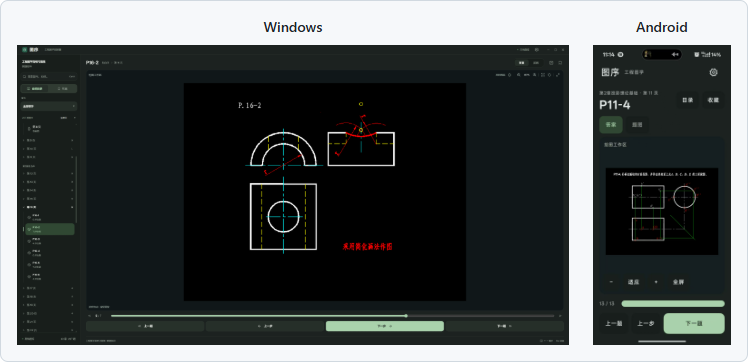
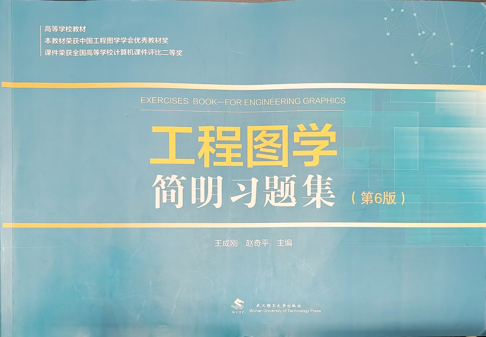
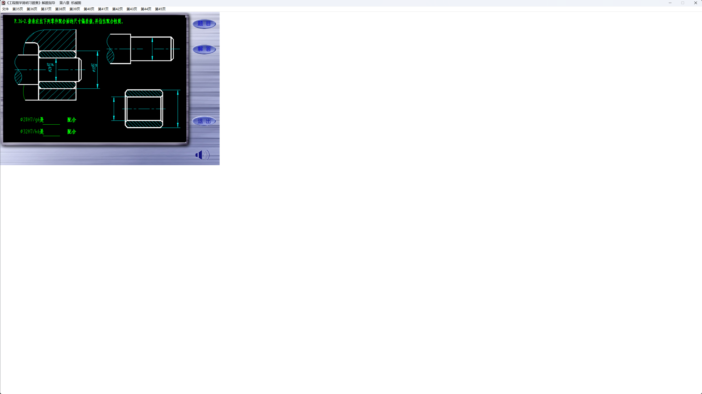

# 图序

**工程图学答案阅读器 · Windows / Android**

[](./docs/RELEASING.md)
[](#平台支持)
[](#平台支持)
[](./LICENSE)
[](./content/README.md)
[](#主要功能)

按章节和页码找到答案，单步查看绘图过程，在电脑和手机上放大、拖动和查看局部详图。

[界面预览](#界面预览) · [主要功能](#主要功能) · [适用教材](#适用教材) · [项目缘起](#项目缘起) · [快速开始](#快速开始) · [开发文档](#文档与源码) · [许可](#许可)

> **题库已包含在仓库中。** 源码与解包后的题目、答案、绘图步骤、动画和视频一同提供，克隆后可直接构建完整题库版，无需重新解包原软件。

## 界面预览



Windows（左）支持章页检索、鼠标缩放与单步绘图；Android（右）支持双指缩放与横屏阅读。

查看高清原图：[Windows](./docs/screenshots/windows-reader.png) · [Android](./docs/screenshots/android-reader.jpg)

截图中的书籍与课件内容保留原有权利；两端默认使用随仓库提供的完整题库。

## 主要功能

| 功能 | 使用方式 |
| --- | --- |
| 按章页检索 | 章节 → 页 → 题目，支持题号、别名及组合条件；Windows 可用 `Ctrl+K` 快速搜索 |
| 单步绘制 | 查看每一步和最终答案，用进度条定位绘制阶段 |
| 连续翻阅 | 固定排列“上一题、上一步、下一步、下一题”，没有步骤时相邻翻题按钮扩展，便于连续点击 |
| 矢量显示 | 保留绘图指令或矢量路径，放大后重新绘制；原始位图仍按位图显示 |
| 图内详图 | 点击图上区域查看局部、补充说明或动画，再返回总图 |
| 自由查看 | Windows 鼠标拖动、滚轮缩放；Android 单指拖动、双指缩放，并支持横屏全屏 |
| 阅读偏好 | 深色、浅色、跟随系统，收藏与最近阅读 |
| 离线使用 | 图稿、索引和已提供的媒体保存在本地，阅读无需联网 |

| 题目入口 | 单步过程 | 绘图场景 | 模型动画 | 视频 |
| :---: | :---: | :---: | :---: | :---: |
| 207 | 46 套 | 1316 | 14 段 | 6 个 |

## 适用教材

**适用于武汉理工大学出版社出版、王成刚与赵奇平主编的《工程图学简明习题集》（第6版）。** 本项目的章节、页码和题号按该版本组织，使用时请先核对教材版本。



## 项目缘起

《工程图学简明习题集》的原版答案阅读器已经是很多年前的产物，部分依赖库的年代甚至可以追溯到 **1997 年**。随着系统和设备更新，使用中的几个问题越来越明显：

- **启动特别慢**：打开程序、进入阅读需要较长等待。
- **文件零散**：不同章节分散在多个程序和配套文件中，查题时需要来回寻找、切换。
- **无法适配高分屏**：绘图区和旧界面不能随高分辨率屏幕合理缩放，图稿只占窗口一角，留下大片空白。

原版安卓阅读器则是 **32 位应用**，在部分仅支持 64 位应用的现代 Android 设备上，已经无法正常安装或运行。关于这类设备的兼容要求，可参见 [Android 官方说明](https://developer.android.com/games/optimize/64-bit)。

为了让这些教学内容继续方便地使用，我通过逆向分析原版课件的内容组织、绘图步骤和图内交互，重新编写了 **图序**，并分别实现 Windows 与 Android 版本。

项目围绕两个核心需求展开：**按章节和页码找到答案，以及单步查看绘图过程**。在此基础上，保留矢量重绘、局部详图和原有媒体交互，重新设计检索、导航和阅读界面，让旧课件更适合今天的电脑和手机。

各章节统一收进一个阅读器，通过目录和索引直接定位；绘图区随窗口调整，并支持缩放和拖动，方便在高分屏上查看图稿细节。

### 原版软件



原版软件在高分屏下的实际显示：即使窗口放大，课件仍集中在左上角，无法随窗口充分利用屏幕空间。这也是本项目重新设计显示与缩放方式的原因之一。

教材封面与三张软件截图均由项目作者提供，用于说明适用教材、展示界面及对比旧版。

## 平台支持

| 平台 | 系统要求 | 实现 |
| --- | --- | --- |
| Windows | Windows 10 / 11，x64，WebView2 Runtime | React + TypeScript 界面，C# / WinForms / WebView2 宿主与原生绘图 |
| Android | Android 9（API 28）及以上，包含 ARM64 支持 | Kotlin + Jetpack Compose + 官方 miuix，SVG / Canvas 绘图 |

## 快速开始

本仓库提供阅读器源码，以及**解包后的完整题库与运行资源**：207 个可见题目入口、46 套单步绘制过程、1316 个绘图场景、14 段模型动画和 6 个视频。克隆后即可编译并使用现有题库，无需再运行旧课件或自行提取答案。

Windows 数据位于 [`content/windows`](content/README.md)，Android 数据位于 `apps/android/app/src/main/assets/content`，均包含在源码包内。题库内容与原创代码分别标注权利，不因随仓库提供而转为 MIT 授权。数据格式及检查方式见 [内容说明](docs/CONTENT.md)。

### Windows

准备 Node.js 24、.NET SDK 10.0.403 或兼容的 10.0 功能版本，以及 WebView2 Runtime，在仓库根目录执行：

```powershell
npm --prefix apps/studio ci --ignore-scripts
npm --prefix apps/studio run build
dotnet build apps/desktop/Studio.csproj -c Release
& ./apps/desktop/bin/Release/net10.0-windows/win-x64/DrawingStudio.exe
```

请运行桌面程序，并保留完整输出目录。直接用浏览器打开前端页面无法调用 Windows 原生绘图引擎。

### Android

准备 JDK 21、Android SDK 35，或用 Android Studio 导入 `apps/android`：

```powershell
cd apps/android
./gradlew.bat testDebugUnitTest assembleDebug
```

Linux / macOS 使用 `sh gradlew`。调试 APK 输出至 `app/build/outputs/apk/debug/app-debug.apk`，自动使用本机调试证书。完整环境配置和正式签名方式见 [构建指南](docs/BUILDING.md)。

## 文档与源码

| 文档 | 内容 |
| --- | --- |
| [构建指南](docs/BUILDING.md) | 双端构建、开发环境和测试命令 |
| [架构说明](docs/ARCHITECTURE.md) | 检索索引、绘图引擎及阅读状态 |
| [内容格式](docs/CONTENT.md) | 目录、逐题文档、场景和原创演示 |
| [发布指南](docs/RELEASING.md) | 源码整理、安装器、APK 签名与发布 |
| [本地核验](docs/VALIDATION.md) | 已执行的测试及其范围 |
| [第三方说明](THIRD_PARTY_NOTICES.md) | 依赖、字体、素材和工具的许可证 |

<details>
<summary>查看源码目录</summary>

```text
apps/
  studio/       React 界面、索引与绘图调度
  desktop/      Windows 宿主、窗口和原生通信
  windows/      仍在使用的四份共享 C# 绘图源码
  android/      Kotlin / Compose 安卓应用
  installer/    Windows 安装器
assets/         品牌图标
content/        解包后的 Windows 题目、答案、绘图场景和媒体
samples/        原创绘图示例及生成器
scripts/        公开源码扫描与快照导出
docs/           构建、架构、内容和发布文档
```

</details>

## 常见问题

### 还需要安装原版软件或另找答案文件吗？

不需要。现有解包后的题目、答案、绘图步骤、图内详图、动画和视频均已纳入仓库，两端默认使用这些数据。原始旧 EXE 不作为新阅读器的运行依赖。[原创小示例](samples/README.md) 仍保留，用于独立演示和开发调试；原稿已有的空图链接等缺失说明也保留，不将其当成已修复。

### 绘图区显示的是图片，还是矢量？

Windows 引擎按绘图指令重新绘制，再把当前画面作为显示缓冲交给界面；缩放时仍使用源场景。Android 使用 SVG 路径与 Canvas 绘制。源内容本身是位图的部分，仍然是位图。

### Windows 为什么可能提示“未知发布者”？

当前安装入口尚未使用受信任的 Authenticode 证书签名，可能出现 SmartScreen 提示。制作安装包不会自动消除此提示，详见 [微软说明](https://learn.microsoft.com/en-us/windows/apps/package-and-deploy/smartscreen-reputation)。

## 反馈与支持

欢迎通过 Issues 提交问题或建议。报告问题时，请附上系统与软件版本、题号、复现步骤及必要截图；截图前请遮挡个人信息。

作者：**PhoenixTree**。应用设置中的“支持我”提供自愿支持入口，关于页面保留署名与反馈信息。

感谢原课件制作者留下的教学内容，以及本项目使用的开源组件。阅读界面组织参考了 [Readest](https://github.com/readest/readest)，Android 控件使用官方 [miuix](https://github.com/compose-miuix-ui/miuix)。

## 许可

本项目原创代码与原创演示采用 [MIT 许可证](LICENSE)，允许在保留许可与署名的前提下使用、修改和分发。第三方依赖、字体、工具及作者收款码保留各自权利，见 [第三方说明](THIRD_PARTY_NOTICES.md)。

原课件、原书答案及其衍生素材不属于本项目 MIT 授权范围。源码开源不构成对这些教学内容的传播授权。绘图一致性检查也不等同于学科答案审校，原稿缺失内容仍需另外核对。
